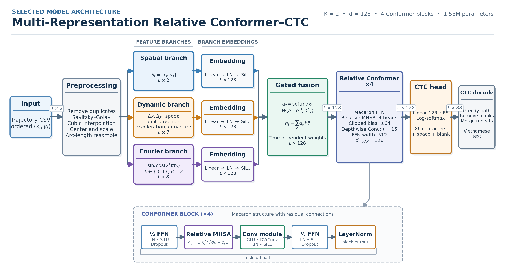

# Vietnamese Air-Writing Recognition

Standalone character-level Vietnamese air-writing recognition from ordered 2D
trajectories. The model combines spatial coordinates, motion dynamics, and
multi-scale Fourier features with adaptive gated fusion, a relative-position
Conformer encoder, and CTC decoding.

This directory contains everything required for inference: source code, two
checkpoints, and three example trajectories. It does not require the full
training dataset or a GPU.



## Results

Two checkpoints ship here, each best at a different thing:

| Checkpoint | Protocol | CER ↓ | WER ↓ | Exact accuracy ↑ |
|---|---|---:|---:|---:|
| `best_fourier_k2.pt` | Source-disjoint (standard split) | **1.77%** | 5.55% | 94.77% |
| `best_lexical_disjoint_dynf_d20.pt` | Lexical-disjoint (unseen phrases) | **18.67%** | 51.1% | 39.9% |

The second number is the more demanding test: the lexical-disjoint protocol
holds out entire *phrases*, so nothing in the test set was ever seen — even
partially — during training. The model has to compose Vietnamese characters
from motion it has learned, not recall a phrase it memorized. Reaching that
number required dropping the raw-coordinate branch and tuning dropout — no
architecture change — which nearly halved the error versus the unmodified
model (33% → under 20%, see the paper for the full ablation).

Along the way we found that the fusion gate genuinely specializes by
trajectory geometry — the motion branch's weight rises specifically at sharp
turns and diacritic strokes (Spearman ρ = 0.57 with local curvature) — and
that residual errors are dominated by base-letter confusions (e.g. *bí* → *bú*)
rather than tone-mark placement, by more than 5 to 1. Full detail is in the
paper this package accompanies.

## Installation

Python 3.10 or newer is required. Clone the repository, enter its root, and
install it in a virtual environment:

```bash
git clone https://github.com/vnminh/Air-writing-soict.git
cd Air-writing-soict

python3 -m venv .venv
source .venv/bin/activate
python -m pip install --upgrade pip
python -m pip install -e .
```

Windows PowerShell users can activate the environment with:

```powershell
.venv\Scripts\Activate.ps1
python -m pip install --upgrade pip
python -m pip install -e .
```

PyTorch automatically uses CUDA when an appropriate CUDA build is installed.
CPU inference works without a GPU.

## Run inference

The shortest complete example is:

```bash
python -m airwriting examples/bao_gio.csv
```

The checkpoint is found automatically at `models/best_fourier_k2.pt` — the
source-disjoint model, best for everyday use. To try the lexical-disjoint
model instead (better on phrases unlike anything in training), pass it
explicitly:

```bash
python -m airwriting examples/bao_gio.csv \
  --checkpoint models/best_lexical_disjoint_dynf_d20.pt
```

An explicit path and device can also be supplied for the default checkpoint:

```bash
python -m airwriting examples/bao_gio.csv \
  --checkpoint models/best_fourier_k2.pt \
  --device cpu
```

The command prints UTF-8 JSON containing the prediction, point counts, device,
and mean branch weights:

```json
{
  "source": "examples/bao_gio.csv",
  "checkpoint": "models/best_fourier_k2.pt",
  "prediction": "bao giờ",
  "raw_points": 156,
  "model_points": 128,
  "device": "cpu",
  "mean_fusion_weights": {
    "spatial": 0.1805,
    "dynamic": 0.4088,
    "fourier": 0.4107
  }
}
```

The installed console command is equivalent:

```bash
airwriting-infer examples/bao_gio.csv
```

### Process multiple files

The model is loaded once when several CSV files are passed together. Use
`--jsonl` to print one compact JSON record per file:

```bash
python -m airwriting \
  examples/bao_gio.csv \
  examples/ngon_nui_cao_voi_voi.csv \
  examples/bi_failure.csv \
  --jsonl
```

Expected predictions:

| File | Reference | Prediction | Outcome |
|---|---|---|---|
| `bao_gio.csv` | `bao giờ` | `bao giờ` | Correct |
| `ngon_nui_cao_voi_voi.csv` | `ngọn núi cao vời vợi` | `ngọn núi cao vời vợi` | Correct |
| `bi_failure.csv` | `bí` | `bú` | Vowel substitution |

### Select a device

```bash
# Automatically select CUDA when available, otherwise CPU
python -m airwriting examples/bao_gio.csv --device auto

# Force CPU
python -m airwriting examples/bao_gio.csv --device cpu

# Require CUDA; raises an error when CUDA is unavailable
python -m airwriting examples/bao_gio.csv --device cuda
```

## Input CSV format

Each file represents one trajectory and must contain:

- an `x,y` header;
- at least two coordinate rows;
- finite numeric values;
- rows ordered by recording time.

Example:

```csv
x,y
568.0,486.0
567.0,477.0
565.0,469.0
```

The model accepts trajectories of different lengths. It removes consecutive
duplicates, smooths and interpolates the path, normalizes its position and
scale, and resamples it to 128 points using arc length.

## Python API

Use `AirWritingRecognizer` when integrating the model into another
application. Constructing the recognizer loads the checkpoint once.

```python
from airwriting.inference import AirWritingRecognizer

recognizer = AirWritingRecognizer(device="auto")

result = recognizer.predict_csv("examples/bao_gio.csv")
print(result["prediction"])

results = recognizer.predict_many(
    [
        "examples/bao_gio.csv",
        "examples/bi_failure.csv",
    ]
)
```

An in-memory NumPy array with shape `(T, 2)` can be passed directly:

```python
import numpy as np

points = np.array(
    [
        [568.0, 486.0],
        [567.0, 477.0],
        [565.0, 469.0],
    ],
    dtype=np.float32,
)

result = recognizer.predict_points(points)
print(result["prediction"])
```

To use a checkpoint stored elsewhere, pass `checkpoint_path` or set the
`AIRWRITING_CHECKPOINT` environment variable:

```bash
export AIRWRITING_CHECKPOINT=/path/to/checkpoint.pt
python -m airwriting /path/to/trajectory.csv
```

## Recognition pipeline

1. Preprocess and resample the trajectory to 128 points.
2. Compute three feature branches:
   - spatial coordinates, with 2 values per point;
   - dynamic descriptors, with 7 values per point;
   - deterministic Fourier features, with 8 values per point for K=2.
3. Embed each branch into 128 dimensions.
4. Compute time-dependent softmax weights and fuse the branches.
5. Encode the sequence with four relative-position Conformer blocks.
6. Project to 88 outputs: 86 corpus characters, one space, and one CTC blank.
7. Apply greedy CTC decoding to obtain the Vietnamese string.

The architecture configuration, preprocessing parameters, output tokens, and
model state are stored together in the checkpoint.

## Training

`airwriting.train` trains a model from scratch on your own copy of the
dataset (or any data in the same directory layout). It needs a GPU to finish
in reasonable time, but will fall back to CPU automatically.

```bash
python -m airwriting.train \
  --data-root /path/to/VNI_airwriting \
  --manifest manifests/split.json \
  --output-root runs --name my_run
```

If `--manifest` doesn't exist yet, it's generated automatically — pass
`--protocol source` (default; same labels in every split) or `--protocol
lexical` (phrases held out entirely from training, the harder generalization
test used for `best_lexical_disjoint_dynf_d20.pt`). Architecture and
optimization settings (representation, fusion, backbone, dropout, epochs,
learning rate, ...) are all flags; run `python -m airwriting.train --help`
for the full list. The resulting checkpoint is compatible with
`AirWritingRecognizer` and the inference CLI above.

## Directory contents

```text
.
├── README.md
├── pyproject.toml
├── __init__.py
├── __main__.py
├── cli.py
├── inference.py
├── train.py
├── data.py
├── metrics.py
├── models.py
├── examples/
│   ├── bao_gio.csv
│   ├── ngon_nui_cao_voi_voi.csv
│   └── bi_failure.csv
├── models/
│   ├── best_fourier_k2.pt
│   └── best_lexical_disjoint_dynf_d20.pt
└── assets/
    └── best_model_architecture.png
```

`experiment.py` and `manifest.py` power `train.py` (training loop and split
construction, respectively). Neither is required for inference-only use.

## Troubleshooting

### Checkpoint not found

Run the command from the repository root, pass `--checkpoint`, or set
`AIRWRITING_CHECKPOINT`.

### CUDA requested but unavailable

Use `--device cpu` or install a PyTorch build compatible with the local CUDA
driver.

### CSV rejected

Confirm that the header is exactly `x,y`, every row contains numeric values,
and the file contains at least two finite points.

## Limitations

The model recognizes tracked 2D trajectories. It does not detect fingertips
from images or video, and its reported metrics do not include errors caused by
lighting, viewpoint, occlusion, or upstream hand tracking. The source IDs in
the evaluation data are not confirmed writer identities, so the results should
not be interpreted as writer-independent evaluation. Long trajectories and
short discriminative vowel or diacritic movements remain the main failure
modes.
